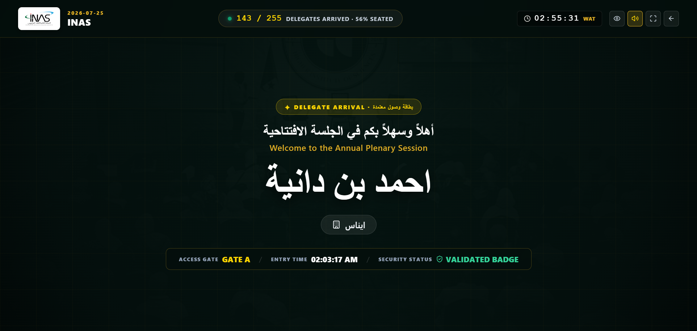
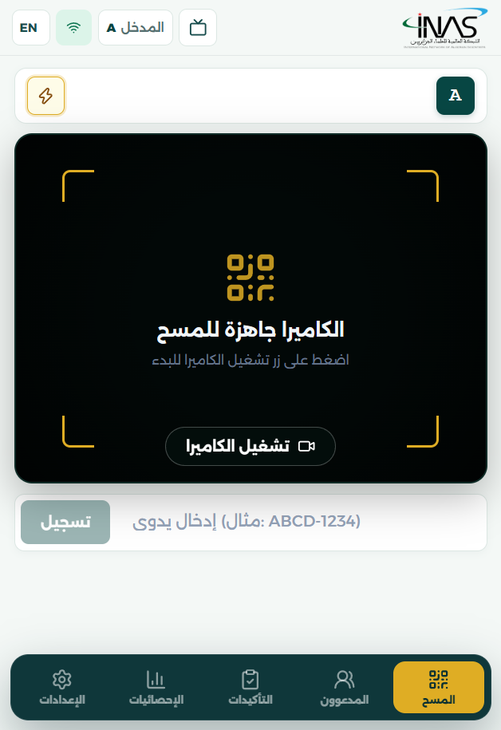
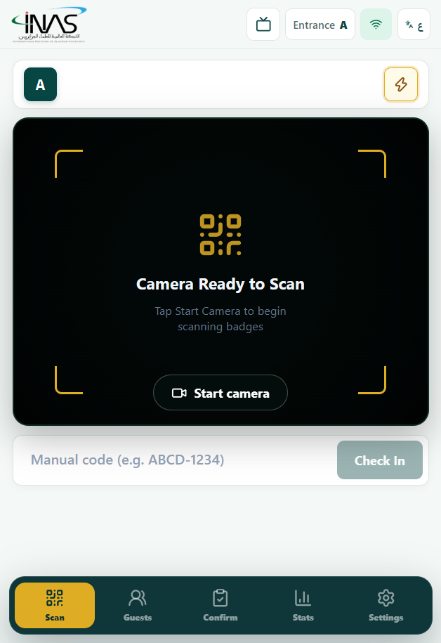
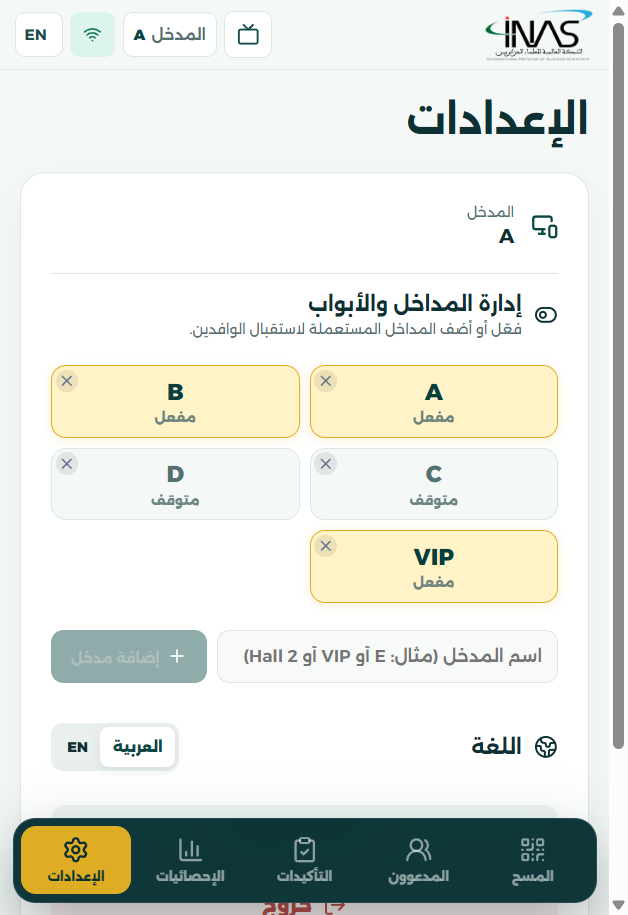
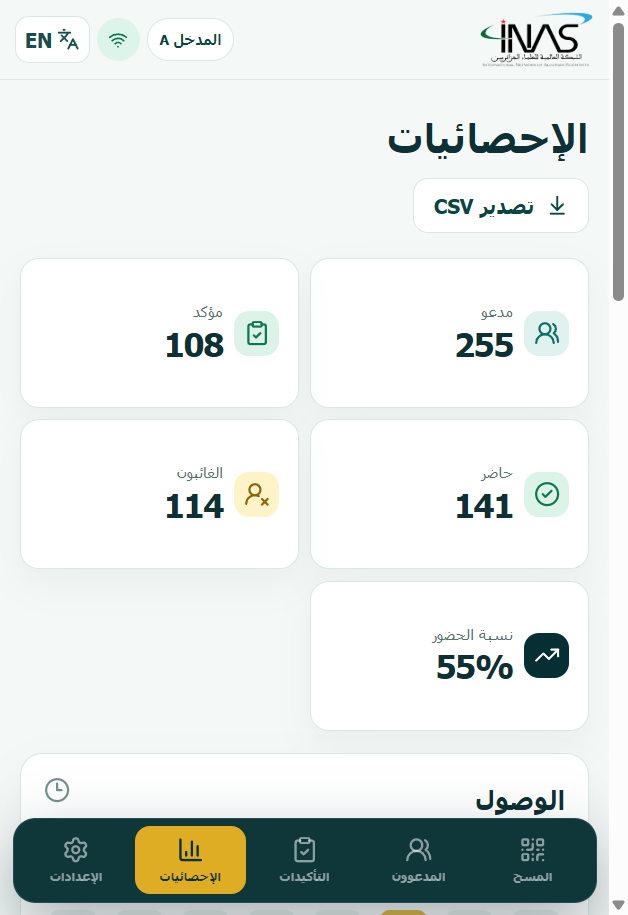
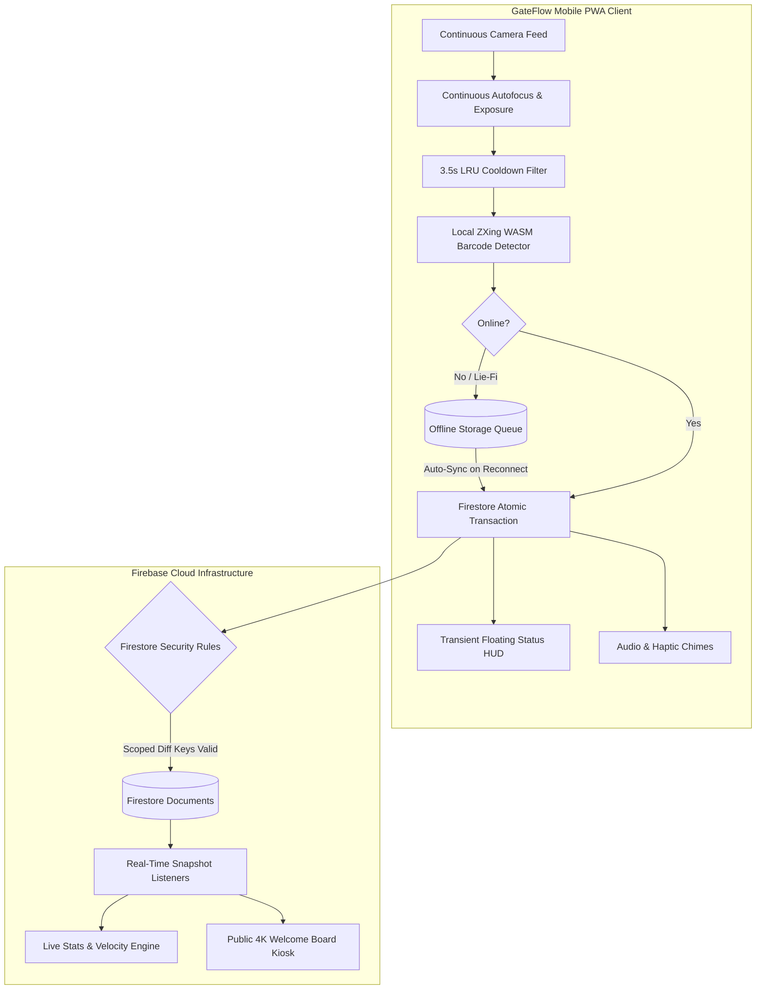

# GateFlow — Ultra-Fast, Offline-First QR Event Check-in & Gate Management System

<p align="center">
  <strong>Production-grade, offline-resilient event check-in, real-time arrival velocity, and gate telemetry platform built with React, Vite, TypeScript, and Firebase.</strong>
</p>

<p align="center">
  <a href="https://qr-scan-2501b.web.app"></a>
  <a href="https://qr-scan-2501b.web.app/#welcome-board"></a>
</p>

<p align="center">
  
  
  
  
  
  
  
</p>

---

## 📺 Public Welcome Board Kiosk (1080p / 4K Kiosk Screen)

GateFlow includes a standalone public screen view (`#welcome-board`) engineered for auditorium entrance projectors, LED displays, and reception TV kiosks.

<p align="center">
  
</p>

- **Real-Time Delegate Salute**: Automatically flashes a monumental welcome card when an attendee scans in at any entrance, showing their full name, academic affiliation, entrance gate, and entry timestamp.
- **Dynamic Event Theming**: Automatically driven by the event record metadata (`title`, `topic`, `subtitle`, `venue`, `date`) — adapts instantly to any conference or summit without hardcoded text.
- **Attendance & Velocity Telemetry**: Live delegate counter (`143 / 255 DELEGATES ARRIVED · 56% SEATED`), real-time precision seconds clock, and privacy masking mode.

---

## 📱 Mobile Visual Showcase (Samsung Galaxy S24 & iOS PWA)

<p align="center">
  
  &nbsp;
  
  &nbsp;
  
  &nbsp;
  
</p>

<p align="center">
  <em>(Screenshots captured directly from the live production PWA running on mobile viewports)</em>
</p>

---

## ⚡ Core Features & Engineering Highlights

### 🚀 Continuous "Speed-Gate" Burst Scanning (< 0.5s Throughput)
- **Zero Sensor Teardown**: Keeps the camera sensor active continuously throughout high-throughput arrival rushes.
- **Pro Hardware Camera Pipeline**: Injects continuous autofocus (`focusMode: "continuous"`), auto exposure (`exposureMode: "continuous"`), and auto white balance via `MediaStreamTrack.applyConstraints`.
- **Transient HUD Feedback**: Instant status cues (green verified, amber duplicate, red invalid) display via a floating card with auto-dismiss timers, freeing staff from touching screens between scans.
- **In-Memory Cooldown Cache**: 3.5-second LRU debounce prevents double-reads of the same ticket without delaying scans of subsequent attendees.

### 🚪 Dynamic Gate & Entrance Management
- **Custom Gate Provisioning**: Add custom entrances (e.g., Gate A, B, C, VIP, Hall 2) on the fly in Settings without redeploying code.
- **Instant Switching & Deletion**: Toggle active entrances, delete unused gates, and automatically persist entrance configurations to local storage with multi-station auth routing.

### 📊 Real-Time Arrival Velocity & Gate Distribution
- **Rolling Arrival Velocity**: Calculates check-in speed (delegates/minute) in real-time over 5-minute and 15-minute rolling windows.
- **Peak Velocity Tracking**: Automatically identifies peak check-in bottlenecks across historical ingress intervals.
- **Multi-Gate Ingress Distribution**: Compares delegate load across all active gates to balance line congestion in real time.

### 📶 Offline-First Resiliency & WASM Barcode Detection
- **Self-Contained Offline WebAssembly**: Pre-caches `zxing_reader.wasm` directly in Service Worker Cache Storage (`workbox-precache-v2`). Decodes QR codes completely offline without relying on external CDN connections.
- **Deadlock-Free Offline Queue**: Scans recorded during Wi-Fi drops or "Lie-Fi" conditions are safely queued in local storage and synchronized sequentially upon reconnect.
- **Offline Duplicate Conflict Alerts**: If an attendee is admitted offline at Gate A while simultaneously checked in at Gate B, gate staff receive an immediate alert upon synchronization.

### 🔤 Bespoke Editorial Typography & Bilingual Design System
- **Alexandria**: Ultra-clean, modern geometric Arabic typeface crafted for high-legibility signage and apps.
- **Plus Jakarta Sans**: Crisp, international geometric Latin typography.
- **JetBrains Mono**: Precision monospace font for badge codes, gate letters, and real-time clocks.
- **Zero Text Overflow**: All buttons, status chips, and badges are proportioned with standardized heights and radii for seamless responsiveness across phone, tablet, and TV screens.

### 🛡️ Enterprise Security & Invariants
- **Cryptographic Ticket Privacy**: Badges encode only `INAS1.<eventId>.<random-256bit-token>`. Attendee PII (names, phone numbers, emails) is never exposed in raw QR codes.
- **Atomic Firestore Transactions**: Check-ins execute via `runTransaction`, strictly serializing concurrent scans across multiple entrances down to the millisecond.
- **Scoped Diff Keys**: Firestore security rules restrict update operations by type, ensuring check-in transactions can only update check-in timestamps and gate identifiers.

---

## 🏗️ Architecture & Data Flow



---

## 📂 Project Organization

```text
├── public/                     # Static assets, icons, PWA manifest, and ZXing WASM
│   ├── inas-icon-192.png       # PWA app icons (192x192, 512x512)
│   ├── inas-logo.png           # High-resolution vector branding
│   ├── audience-hall.jpg       # High-definition venue ambient background for Kiosk
│   └── zxing_reader.wasm       # Offline-first BarcodeDetector WASM binary (1.09 MB)
├── src/
│   ├── assets/                 # Embedded SVG graphics and branding
│   ├── components/             # Reusable UI components (AppShell, LoginScreen, BrandLogo)
│   ├── data/                   # Demo datasets, schedules, and test tickets
│   ├── lib/
│   │   ├── api.ts              # Firebase client SDK, transactions, and session engine
│   │   ├── domain.ts           # Business logic, Arabic normalization, statistics calculation
│   │   ├── entrances.ts        # Dynamic Gate & Entrance manager
│   │   ├── firebase.ts         # Firebase initialization with multi-tab IndexedDB cache
│   │   ├── i18n.ts             # Bilingual Arabic / English copy dictionaries
│   │   ├── invitationPdf.ts    # Secure client-side ticket PDF rendering engine
│   │   ├── offlineQueue.ts     # Resilient, deadlock-free offline sync queue
│   │   ├── p2pMesh.ts          # Local WebRTC P2P Mesh invariant sync engine
│   │   └── scanner.ts          # Pro camera hardware lifecycle, autofocus & wake lock
│   ├── screens/                # Core screens
│   │   ├── ScanScreen.tsx      # Speed-Gate burst scanner & manual entry dock
│   │   ├── PeopleScreen.tsx    # Paginated attendee directory & instant search
│   │   ├── ConfirmationsScreen.tsx # RSVP status tracking & confirmation notes
│   │   ├── DashboardScreen.tsx # Real-time velocity analytics, arrival charts & gate stats
│   │   ├── SettingsScreen.tsx  # Dynamic gate manager, language toggle, app download
│   │   └── WelcomeBoardScreen.tsx # Public 1080p/4K TV Welcome Board screen
│   ├── styles.css              # Custom responsive stylesheet (Alexandria + Plus Jakarta Sans)
│   ├── App.tsx                 # Root application shell & view routing
│   └── main.tsx                # Entry point, Service Worker registration & persistence
├── functions/                  # Cloud Functions (Backend verification & admin tools)
├── email-automation/           # (Optional) Google Apps Script batch email invitation console
├── docs/screenshots/           # High-resolution mobile & TV screenshot showcase
├── firebase.json               # Firebase Hosting headers (CSP, HSTS, WASM caching)
├── firestore.rules             # Production security rules with scoped diff key validation
└── vite.config.ts              # Vite PWA configuration with Workbox font caching rules
```

---

## 🚀 Getting Started

### Prerequisites
- Node.js 20+
- npm or pnpm
- A Firebase project (with Firestore, Authentication, and Hosting enabled)

### 1. Installation
Clone the repository and install dependencies:

```bash
git clone https://github.com/ayoubsarri/GateFlow.git
cd GateFlow
npm install
```

### 2. Environment Configuration
Copy the example environment file:

```bash
cp .env.example .env.local
```

Fill in your Firebase credentials in `.env.local`:
```env
VITE_FIREBASE_API_KEY=your_api_key
VITE_FIREBASE_AUTH_DOMAIN=your_project.firebaseapp.com
VITE_FIREBASE_PROJECT_ID=your_project_id
VITE_FIREBASE_STORAGE_BUCKET=your_project.firebasestorage.app
VITE_FIREBASE_MESSAGING_SENDER_ID=your_sender_id
VITE_FIREBASE_APP_ID=your_app_id
VITE_EVENT_ID=your-event-2026
VITE_ENTRANCE_A_EMAIL=station-a@your-domain.org
VITE_ENTRANCE_B_EMAIL=station-b@your-domain.org
```

> **Note**: Without Firebase credentials configured, GateFlow runs automatically in an interactive **Offline Demo Mode** with mock attendees, allowing full UI and feature testing out of the box.

### 3. Run Development Server
```bash
npm run dev
```
Open your browser at `http://localhost:5173`.

To preview the TV Welcome Board Kiosk directly:
```
http://localhost:5173/#welcome-board
```

### 4. Run Automated Tests
```bash
npm run test:web
```
Executes the Vitest test suite covering domain normalization, statistics calculation, and attendance invariants.

### 5. Build for Production
```bash
npm run build
```
Compiles TypeScript, bundles code into optimized chunks (`scanner`, `firebase`, `icons`, `ui`), and generates the Workbox Service Worker precaching the WASM reader and Google Fonts.

---

## 🌐 Production Deployment

Deploy to Firebase Hosting with a single command:

```bash
npx firebase deploy --only hosting,firestore:rules
```

The configuration in `firebase.json` automatically establishes:
- **Strict Security Headers**: Content Security Policy (CSP), `X-Frame-Options: DENY`, `X-Content-Type-Options: nosniff`.
- **WASM Acceleration**: 1-year immutable caching headers (`Cache-Control: public,max-age=31536000,immutable`) on `/*.wasm`.
- **Permissions Policy**: Camera hardware access scoped strictly to the application origin.

---

## 🏛️ Proven In Production

**GateFlow** was originally deployed as the official check-in and gate management system for the **INAS National Quality Forum 2026** (*الملتقى الوطني لضمان الجودة*), organized by the **International Network of Algerian Scientists and Experts (INAS)** at **HIS University in Algiers**. 

The software processed attendee registrations seamlessly across multiple simultaneous venue entrances with zero downtime, zero scan bottlenecks, and real-time welcome projections.

---

## 📄 License

Licensed under the [MIT License](LICENSE).
